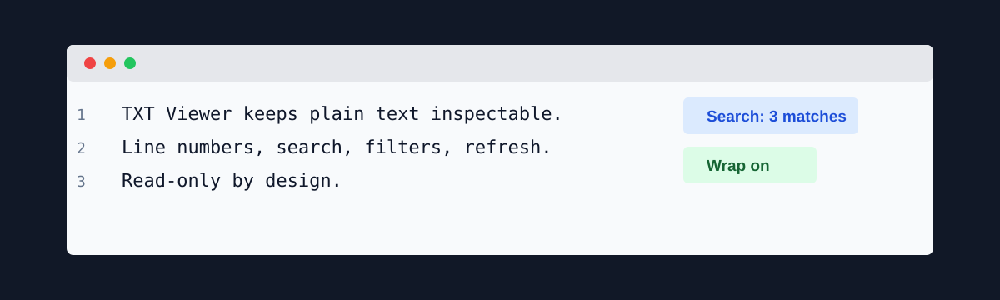
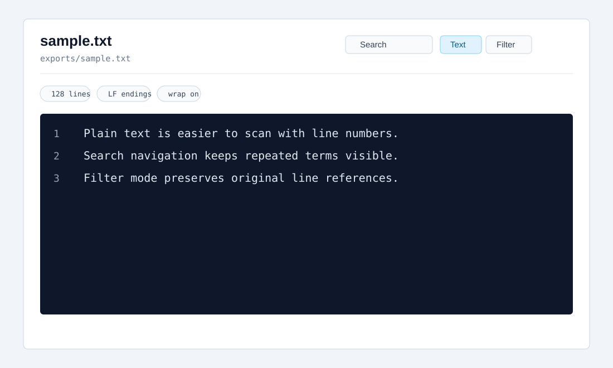

<p align="center">
  
</p>

<p align="center">
  <a href="https://github.com/viggomeesters/obsidian-txt-viewer/releases/latest"></a>
  <a href="LICENSE"></a>
  
  
</p>

# TXT Viewer

TXT Viewer is a read-only plugin for inspecting `.txt` files with line numbers, search navigation, filtering, line-ending warnings, and large-file guards.

It is not a text editor. It is built for quick inspection of plain text exports, AI output, notes from other systems, and generated files where opening a raw text file is not enough context.



## Features

- Opens `.txt` files in a dedicated view.
- Shows stable line numbers.
- Supports soft wrap on/off.
- Searches within the file and navigates between matching lines.
- Offers a filter mode that shows only matching lines while preserving original line numbers.
- Shows line count, character count, byte count, line-ending type, wrap status, filter status, and render cap status.
- Reports mixed line endings and possible binary content.
- Refreshes the file after external changes.
- Renders large files with caps to keep the view responsive.
- Stays read-only by design: it never writes back to text files.

## Large files

TXT Viewer renders the first 10,000 lines in normal text mode. Filter mode renders the first 1,000 matching lines. Additional lines are counted and reported in the status or warning area.

## Privacy and security

TXT Viewer does not make network requests and does not send vault content to external services. It does not use the system clipboard. It reads files through the vault API and renders a local view.

## Why read-only?

Plain text looks simple, but editing still creates risk around encodings, line endings, generated output, and accidental changes. TXT Viewer intentionally avoids writing to disk in v0.1.

## Installation

### Community plugin directory

TXT Viewer is prepared for Community plugin directory submission. Once accepted, it can be installed from **Settings -> Community plugins -> Browse**.

### Manual installation

Until the community directory submission is accepted:

1. Download `main.js`, `manifest.json`, and `styles.css` from the [latest release](https://github.com/viggomeesters/obsidian-txt-viewer/releases/latest).
2. Create this folder in your vault: `.obsidian/plugins/txt-viewer/`.
3. Put the downloaded files in that folder.
4. Reload the app.
5. Enable **TXT Viewer** in **Settings -> Community plugins**.

### BRAT installation

For beta testing, install the plugin with [BRAT](https://github.com/TfTHacker/obsidian42-brat) using this repository URL:

```text
https://github.com/viggomeesters/obsidian-txt-viewer
```

## Usage

Open any `.txt` file in your vault. The file opens with TXT Viewer.

Use the toolbar to:

- search inside the file
- move to the previous or next matching line
- switch between full text and filtered lines
- toggle soft wrap
- refresh the file after external changes

## Development

```bash
npm install
npm run build
npx tsc --noEmit
npm test
```

For local development, copy or symlink this repository into `.obsidian/plugins/txt-viewer/` inside a test vault.

## Release process

Community plugin files are installed from GitHub releases. For each release:

1. Update `manifest.json`, `package.json`, and `versions.json`.
2. Run `npm install`, `npm run build`, `npx tsc --noEmit`, and `npm test`.
3. Create a GitHub release whose tag exactly matches `manifest.json.version`.
4. Attach `main.js`, `manifest.json`, and `styles.css` as release assets.

The repository includes a GitHub Actions release workflow with artifact attestation support. If GitHub Actions is disabled for the owner account, manual releases are still usable, but automated review may show a recommendation about missing artifact attestations.

## Community directory submission

The repository is prepared for Community plugin submission. The remaining submission step must be completed by the repository owner because it requires signing in, linking GitHub, and confirming the developer policies/support commitment.

Submit this repository URL:

```text
https://github.com/viggomeesters/obsidian-txt-viewer
```

Steps:

1. Sign in to [community.obsidian.md](https://community.obsidian.md).
2. Link the GitHub account that owns this repository.
3. Open **Plugins -> New plugin**.
4. Enter the repository URL above.
5. Confirm the developer policies and submit.
6. Address any automated review feedback.

Official references:

- [Submit your plugin](https://docs.obsidian.md/Plugins/Releasing/Submit%20your%20plugin)
- [Obsidian releases repository](https://github.com/obsidianmd/obsidian-releases)

## License

[MIT](LICENSE)
